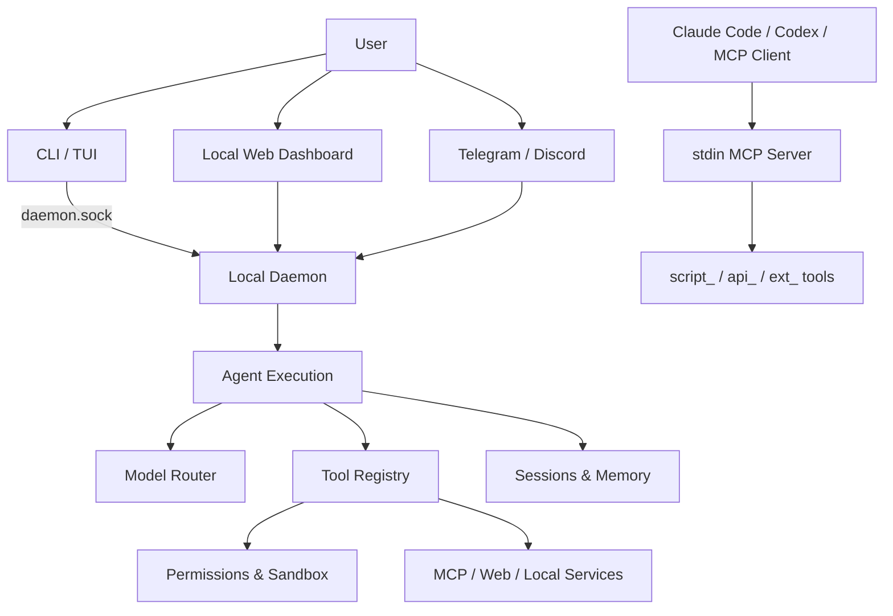
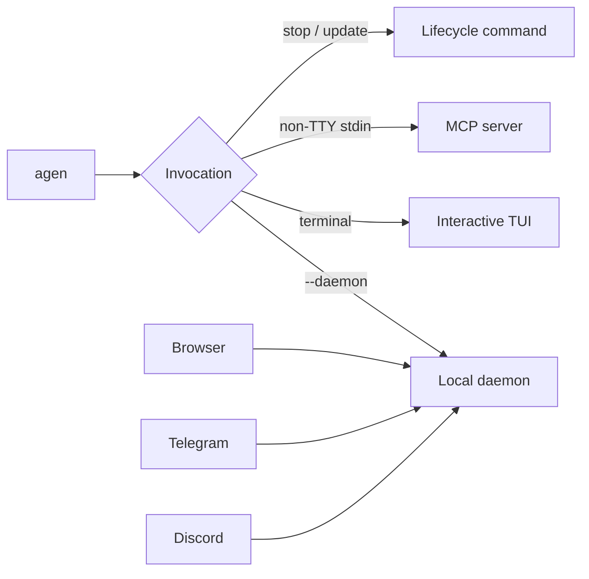
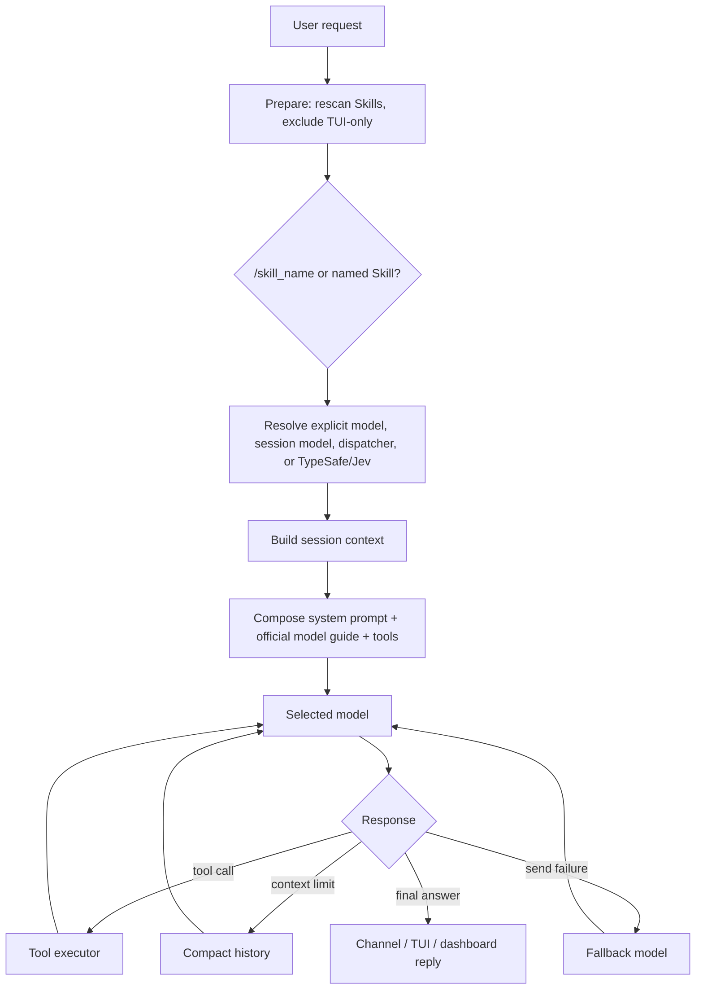
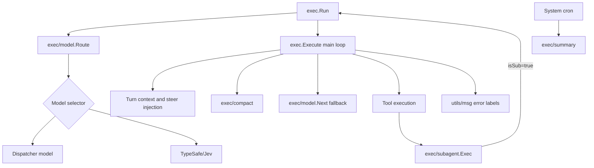
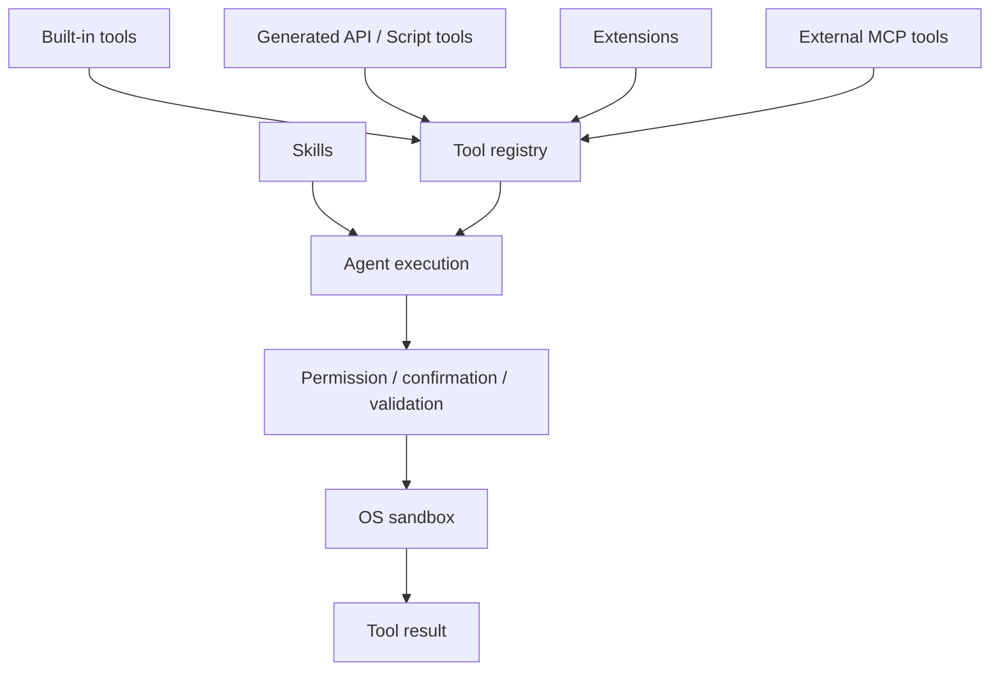
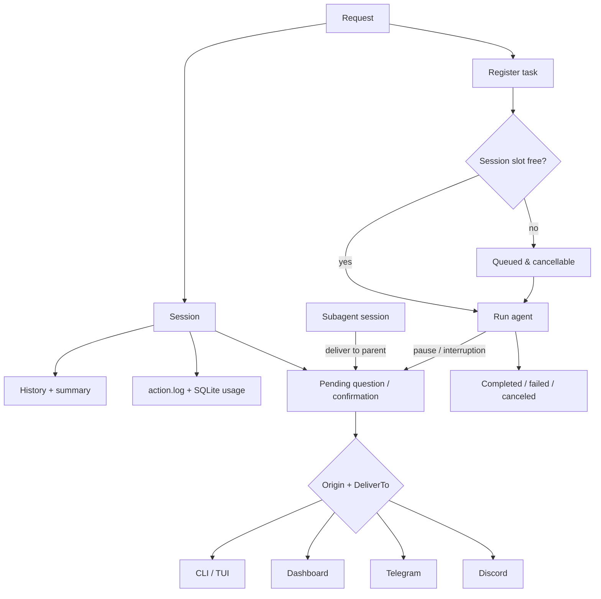
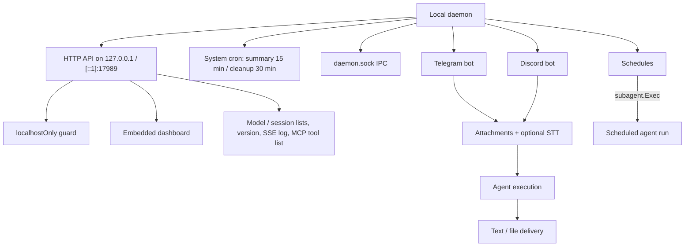
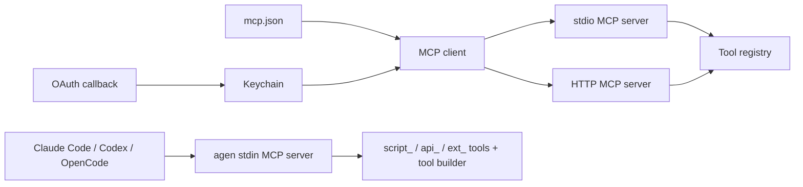
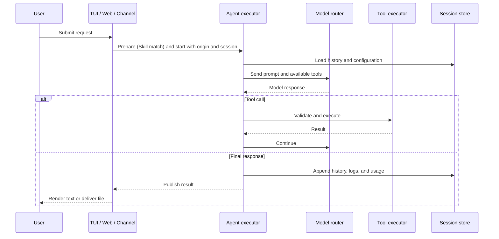
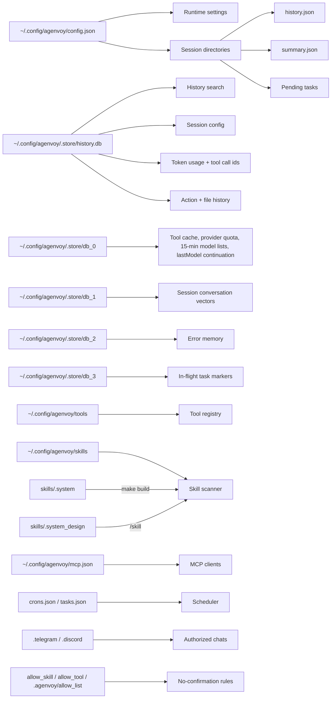

# Agenvoy - Architecture

Last updated: 2026-10-16

> Back to [README](../README.md)

## Overview

Agenvoy is a local Go agent runtime. One execution engine powers the interactive TUI, browser dashboard, Telegram and Discord; the stdin MCP server is a separate, narrower surface that exposes only generated and extension tools. The engine routes each request to a configured model, runs Skills and sandboxed tools, persists session history, schedules, and usage locally, and can create tools when a capability is missing.

## Module: Entry Points

The `agen` binary opens the TUI by default. The local daemon serves the browser dashboard at `http://127.0.0.1:17989` (it also listens on `[::1]:17989`); Telegram and Discord connect outward from that daemon, so no inbound port or public host is required. When stdin is not a terminal, `agen` serves its generated and extension tools through newline-delimited JSON-RPC MCP instead of opening the TUI. `agen --enable-claude-code` enables the `claude-code` provider (the local `claude` CLI as a model); it is refused while a daemon is running, so run `agen stop` first. The daemon it starts carries the flag, and a TUI started later without it follows the running daemon. The daemon runs every agent. The TUI is its client: runs, steer, cancels, confirmation and `ask_user` answers, `/pending` resumes and `/mcp` status, reconnect and tool listing go over the Unix socket `~/.config/agenvoy/daemon.sock` (mode 0600, newline-delimited JSON), and the TUI renders the events streamed back. A TUI run is tied to its connection: closing the TUI stops it and keeps it resumable from `/pending`. When the daemon is unreachable the TUI still opens, the status line shows `Connecting` while it retries every 5 seconds, and input that needs the daemon is held until it connects. When the TUI starts and the daemon is not running, it launches the daemon automatically with `--daemon`.

Every session-backed surface — TUI, dashboard `/send`, pending resume, Telegram, and Discord — enters execution through the same two steps: `exec.Prepare` rescans Skills, excludes TUI-only tools and Skills outside the TUI, and resolves a leading `/<skill_name>`; `exec.Run` then looks up a Skill passed by name, records the input, resolves the model through `exec/model.Route`, builds the session, and runs the agent; subagents and schedules call `exec.Run` directly with `isSub=true`, skipping `Prepare`. Entry points only handle their own transport, authorization, and rendering. Telegram and Discord share one reply pipeline for status updates, chunking, footers, error notices, and attachments. The TUI and the daemon both watch `config.json` and reload the model registry when it changes (the daemon also reconnects the chat bots), and the TUI subscribes to the daemon log so Telegram and Discord verification codes appear in the TUI notice box, which collects every log, warning and error line (last 4 shown, 32 kept, `Tab` scrolls up, `Esc` clears).

With an empty input box, `Shift+F` toggles fast mode for the current process only; the executor, dispatcher and summary calls pass the mode to `go-llm-router`.

## Module: Agent Execution and Model Routing

The runtime matches a request to a Skill when applicable, then selects the configured primary model and fallbacks. A leading `/<skill_name>` is the only inline syntax, and the matched Skill's description is passed to model selection as a routing hint; delegating to a named session goes through the `subagents` tool with a `self_id`. A model named explicitly by the caller (for example the `model` field of `/send`) is used as-is and fails when it is not registered; otherwise the session-bound model or the dispatcher decides. Completion events carry the reasoning level actually used, shown as `model/reasoning` and recorded as `reasoning=` on the `action.log` `done` line. They carry no provider quota: the TUI and web chat fetch the remaining quota for the model that answered after the event arrives, without blocking it — a percentage for `claude-code` (read from `claude -p /usage`, never the API), `codex`, `grok-oauth`, `copilot`, and `ollama-cloud`, a balance for `openrouter` and `deepseek`. The TUI shows it at the right of the status line, the web chat as a badge on the reply; Telegram and Discord footers show none. Dispatcher, summary, image generation, speech-to-text (STT), and text-to-speech (TTS) are separate optional roles. Registered models keep a user-defined priority order that decides fallback, walked downward when the selected model fails or its stream stalls, skipping `pass`-tier models and models on the failed model's provider; each candidate first passes a 10-second health check, for at most 4 rounds, and a session pinned to a model does not fall back. Each model can carry a tier (`S` `A` `B` `C` `pass`) in `model_tag`; without one, the tier is inferred from the model name (for example opus→S, haiku→B, `-mini`→C), and only unrecognized names default to A. The dispatcher orders tiers by the kind of work, and inside a tier it puts the subscription providers `claude-code` and then `codex` first; when one model is registered under several providers, `config.OrderByRank` finally reorders them as `claude-code`, then `codex` / `grok-oauth`, then `copilot`, then the direct API, then `openrouter` (a named or continued model stays first). Work kinds marked long-context — currently `research` — reverse that one step and push `copilot` behind the others at the same tier, because the provider resells a smaller context window for the same model. With `dispatcher_beta` on and `TYPESAFE_API_KEY` in the keychain, the TypeSafe `jev-latest` model replaces the dispatcher model. It classifies the request as `code`, `chat`, `fetch`, `research` or `work`, flags an explicitly named model, and asks whether the request continues the last one so the session's previous model and reasoning can be kept for cache reuse (the previous model is stored as `lastModel:<session>` in ToriiDB db_0 and kept for 5, 30 or 60 minutes depending on the provider); code then ranks models by the tier order for that work type (`research` S first, `work` A first), and any TypeSafe error, or no answer within 3 seconds, falls back to the dispatcher model. Whichever selector runs answers with a kind of work, which also sets the reasoning level (`xhigh`, `none`, `low`, `high`, `medium`); that level is used only when the session reasoning is `auto`, including sessions pinned to a model, and a level passed with the request still wins. Every subagent leg must name its `model` and may add `reasoning` (default `auto`). A named model is used directly, overriding the model the `self_id` session is pinned to; `auto` uses the session's pinned model instead, and only when the session is also `auto` does the normal dispatcher run. A reasoning of `auto` follows the session setting, and if that is still `auto` the model selector decides. The `subagent_dispatch` topic of `reasoning_guide` gives the parent model each work kind's tier order stepped down one level as a whole (for example `code` as A > B > C > S and `work` as B > A > C > S) for reference; the code does not enforce it. Local OpenAI-compatible endpoints are registered as `<name>@<model>`; custom endpoint URLs are kept under `compats` in `config.json`, while the Ollama and llama.cpp defaults that `/model add` detects on their usual ports are built in. History is compacted once it reaches 80% of the model's input window. Window sizes come from `llm-io.agenvoy.com`, refreshed at most hourly before a run and keyed by vendor and model (`nvidia` and `openrouter` models resolve through the vendor inside the model name); `copilot@` models additionally warm a Copilot-specific model-limit cache from the GitHub Copilot models API asynchronously, refreshing at most every 24 hours, and use each chat model's reported `max_context_window_tokens` when available. Unknown Copilot models fall back to the general 128K window; other unlisted models also use 128K. The TUI reports current context tokens against the resolved input window, while compaction begins at 80% of that window. During prompt assembly it injects three layers of `official_guides/`: `_base.md` for every model, then `_vendor_<vendor>.md` when the model name contains that vendor (for example `_vendor_claude.md`, extracted from Anthropic's cross-model guide), then the model guide whose file name the model name contains (longest match wins). `_base_unlisted.md` replaces the last two when neither a model nor a vendor guide matches. Claude keys compare with `.` and `-` normalised to each other, so `claude-opus-5.5.md` matches both `claude-opus-5.5` and Anthropic's own `claude-opus-5-5`. The three layers are merged rather than concatenated: every `## Section` appears once, with the later layers' bullets appended under it and verbatim duplicates dropped. The recommended way to try Agenvoy for free is `gemma4:31b` on `ollama-cloud` (free API key with a usage cap); it is not a required dispatcher or primary model.

## Module: Executor Sub-packages

`internal/agents/exec` is split into sub-packages by responsibility; the main loop only assembles the prompt, sends it to the model and dispatches tools:

- **`exec/model`**: `Route` decides between the explicit model, the session model or a selector (`selectWithLLM` / `selectWithJev`) and builds the fallback list; `Next` picks the next candidate on failure and health-checks it with `CheckAlive` (compat endpoints hit `/models`, other providers go through a probe or health endpoint).
- **`exec/subagent`**: `Exec` creates or reattaches the child session (a `temp-` session reads no history), inherits the parent's work directory, allow-all and `DeliverTo`, excludes file-writing tools and tools with persistent side effects, then runs it through `exec.Run(..., isSub=true)`, at most 3 in parallel; when a question is raised, `waitResume` waits for the answer.
- **`exec/chatbot`**: verification codes for new chats are written to the daemon log and also forwarded to the admin chat set in `config.json` (`tg@<id>` / `dc@<id>`, which must already be authorized).
- **`exec/summary` and `exec.Reset`**: the daemon builds a rolling summary every 15 minutes, preferring the summary model and falling back to the main model while it is cooling down or the content is too large; `Reset(withSummary)` rebuilds the summary first and aborts if it cannot, so no context is lost.
- **`exec/compact`**: past the first turn, once the previous turn's input tokens reach 80% of the window, old history is extracted first and then tool history is compacted; a context-too-long error goes through `TrimFallback`, and a model switch tries `RawToolFallback` before clearing tool history.
- **Turn context and steer**: the work directory, permission mode, `run_tool` tool list, Skill list and `CLAUDE.md` / `AGENTS.md` (when guides are on) are injected every turn as one user message placed before the user input (templates in `configs/prompts/system_prompt/inject/`), so the system prompt stays stable; steer sent during a run is queued over IPC and injected the next turn through `inject/steer.md`, and is cleared on session reset.
- **`/v1/chat/completions`**: skips `Prepare` / `Run` and calls `exec.Execute` directly with a stateless session; all tools are excluded by default and opened only by the agent-mode header.
- **Error messages**: every error is built through `New` / `Wrap` / `Trace` in `internal/utils/msg` in the form `[Label] target: reason`; labels are limited to `Invalid`, `Not found`, `Denied`, `Conflict`, `Limit`, `Unavailable`, `Timeout`, `Upstream`, `Canceled`, `Internal`, and wrapping layers keep the innermost label so agents and logs can tell the category directly.

## Module: Tools, Skills, and Sandbox

Built-in tools, generated API/script tools, installed extensions, and MCP tools share one registry. Every tool is sorted by name; the tool payload carries full schemas only for `find_tools`, `run_tool` and `reasoning_guide`, while the other tools are listed by name in the TurnContext injected every turn, their schemas are delivered as tool output by `find_tools(mode=search)` rather than written back into the tool payload, and they are called through `run_tool(name, args)`, so the serialized tool block stays byte-identical for the whole session and the prompt cache survives. The `claude-code` provider gets no `run_tool`; it receives tool names alone plus the full `find_tools` schema, and calls a tool directly by name once it has the schema. Before execution, the executor checks denied and sensitive paths, command policy, confirmation requirements, argument validation, shell AST validation for `run_command`, and the OS sandbox. Commands run with networking denied; a call that has to reach a host sets `network: true`, which raises a confirmation and skips the read-only allowlist; `sudo` is always refused, and `rm` moves files to the trash instead. Tool confirmation is decided in order: reads of sensitive paths always confirm, an allow-all for the current run skips confirmation, destructive modes always confirm, `open_file` on a URL always confirms, read-only tools and read-only commands skip it, and finally the user's allow-list is checked (global `~/.config/agenvoy/allow_tool` and per-project `<workDir>/.agenvoy/allow_list`, with entries written as `name` or `name(argGlob)`). A normal tool confirmation asks whether to allow that specific tool call. Restricted paths and package-management operations additionally require system verification where the channel supports it. Denied paths and configured denied commands are hard rejected; commands outside the denylist are not an allowlist failure, though they can still enter the normal confirmation flow.

File tools resolve paths through a shared boundary check. `find_files` supports directory listing, filename globbing, and regex content search. Glob results are ordered most recently modified first. Search is paged: `output=files` returns each matching path with its match count and the row numbers of its first five matches, so a precise query can go straight to `read_files`; `output=content` returns the matching lines with optional `context`; `multiline` matches the regex against whole files so `.` crosses newlines while `^` and `$` still anchor lines. Serialized results are capped at 128 KiB. `read_files` handles text and supported document, image, and audio/video formats in batches, with text reads paged at 2048 lines by default. For plain-text files, `around` reads `context` lines (20 by default) on both sides of given rows, merges overlapping windows, and marks skipped text with a `...` line; one path may appear several times in a call and its results are joined in order. `edit_file` provides write, patch, remove, and restore modes. Writing or patching an existing file requires that `read_files` recorded its modification time earlier in the same run and that the on-disk modification time is still unchanged; successful writes refresh that mark, so consecutive patches need no re-read. When a patch anchor does not match exactly, it is retried with curly quotes treated as straight ones, and the replacement keeps the file's curly-quote style. File changes are recorded in SQLite history where available; a failed history record does not undo a completed filesystem write and is reported to the caller. Long-form deliverables go through `write_result` (Markdown or HTML), which writes to the configured output directory (`output_dir`; `~/Downloads` by default, or `~/.config/agenvoy/download` when that folder does not exist) rather than the work directory; HTML is first validated for the QuickUI mount, inline script syntax and template bindings, and on any failure it is not written and the list of problems is returned. Other files made for the user land there too unless the request names a location. `run_command` waits for the process to exit, so commands that start a file watcher (`--watch`, `chokidar`, or a package script that runs one, followed through `sh -c` and `package.json`) are refused before they run. If live data needs a tool that does not exist, the agent can build, test, and retain a new tool. Web Search and file search provide live or local data directly; RAG has no built-in tool and comes from an external MCP server.

Skills are scanned in a fixed order and the first Skill with a given name wins: `<cwd>/.skills`, `<cwd>/.claude/skills`, `~/.config/agenvoy/skills/.system`, `~/.config/agenvoy/skills/.system_design`, `~/.config/agenvoy/skills`, then `~/.claude`, `~/.codex`, `~/.opencode`, `~/.copilot`, and `~/.agents` skills; `skill_source_off` in `config.json` disables individual sources. Other dot-folders inside a scanned directory are skipped. `.system` is rebuilt from `extensions/skills` on every `make build`. `.system_design` holds the official Skills that the TUI `/skill` command clones from `github.com/agenvoy/skill-<name>` (checked) or deletes (unchecked), so a rebuild never removes them. Skills in both folders report their source as `system`, and the dashboard cannot delete them. Activating a Skill by `/<name>` adds a synthetic `run_skill` call whose tool result carries the execution rules and the resolved SKILL.md. The system prompt stays the same with or without a Skill, so switching between a Skill run and plain chat keeps the prompt cache. Compaction and a model switch clear tool history, so the Skill content goes with it; the todo list carries the remaining steps.

## Module: Sessions, Memory, and Task Lifecycle

Every request belongs to a session. The session ID prefix marks its origin: `cli-`, `chat-`, `tg-`, `dc-`, or `temp-`. Session configuration, token usage (for `claude` and `claude-code`, input includes cache writes, matching how other providers report uncached input), action history and file history are stored in SQLite (`history.db`); session directories keep messages, summaries, `action.log`, and pending questions. Active tasks publish short-lived `action:<session>:<task>` markers in ToriiDB and refresh them while running, so pending lists expose only tasks that can actually be resumed. Pending requests have two routing keys: `Origin` selects the listener (CLI/TUI, web, Telegram, or Discord), while `DeliverTo` selects the session window that receives the prompt and result. A TUI connection only takes prompts raised by runs it started, matched by the window hash its runs carry, so several open TUIs never see each other's prompts; runs from other origins (a schedule on a `cli-` session, for example) have no listener and follow the timeout-to-pending path. A subagent runs in its own session but inherits the parent origin and delivers confirmations and `ask_user` prompts back to the parent session. An `ask_user` raised from the TUI is asked inline and the run stays alive; from every other origin the run stops and its state is written to a pending entry, with tool arguments capped at 4 KiB and results at 32 KiB (keeping the first 3/4 and the last 1/4), that a later answer resumes. Tasks are registered before they compete for a per-session concurrency slot, so queued work remains visible and cancellable. A user cancel (TUI cancel or `ctrl+c`, **Abort task**, the cancel API) discards the task's pending entry; a pause or any other interruption stops the run but keeps the entry resumable. The scheduler runs recurring or one-shot scheduler Skills through the subagent path (skipping `Prepare`, with the subagent tool restrictions and a 30-minute timeout).

## Module: Daemon, Dashboard, and Chat Channels

The daemon loads runtime settings, initializes ToriiDB, clears stale in-flight markers, and opens the SQLite history database and usage table, in that order. It then registers the image / audio / chat tools, syncs web assets, checks the sandbox, and registers subagents and the Skill scanner, while MCP servers connect asynchronously in the background. Next it starts the scheduler and two system crons (a summary every 15 minutes, session cleanup every 30 minutes), the config and session watchers, and Telegram / Discord. Finally it registers the web confirmation listener, opens the IPC socket, and starts the HTTP API. Its dashboard is embedded in the binary and served from `/`; during development `AGENVOY_PAGE_DIR` makes it read from disk instead. The HTTP API listens on `127.0.0.1` and `[::1]` only; on top of that, `localhostOnly()` guards session management, model routing / tiers / priority, providers and credentials, MCP configuration, roles (`/v1/role`, with `/v1/rule` as a legacy alias), Skills, schedules, allowlists, runtime configuration, files, usage, channels, voice, error memory, the daemon log and system update. Agent execution (`/v1/send`, `/v1/chat/completions`), confirmation, cancellation, pending tasks, the session list, the model list (`/v1/models`), version, the SSE log, `/v1/mcp/tools` and the dashboard's static assets are left unguarded. The dashboard's System tab compares the running version with the latest GitHub release and can open a terminal running `agen update` (Terminal.app on macOS, `cmd.exe` into the WSL distro, or a Linux terminal emulator). Telegram and Discord require only their bot tokens because the daemon initiates the connection. Since **v0.34.4**, the default voice-input-to-voice-output loop is paused for those channels; STT/TTS tools can still generate audio files and send them through either channel.

## Module: MCP Client and Server

Agenvoy connects to external MCP servers over stdio or streamable HTTP through the official `go-sdk` client, refreshes their tools when their catalog changes, adds their server instructions to the agent system prompt, and can complete OAuth sign-in while storing the token and client id in the keychain. In the other direction, running `agen` with non-terminal stdin serves an MCP server to Claude Code, Codex, OpenCode, and other MCP-compatible clients. It does not share the agent's tool registry or run the agent: it exposes only `script_*`, `api_*` and `ext_*` tools plus `tool_generate_guide`, `list_tools`, `edit_tool`, `test_tool` and `store_secret`, so a client can find, build and call generated tools.

## Data Flow

## Security Boundaries

- The dashboard and HTTP API listen on `127.0.0.1` and `[::1]` only, and management routes additionally pass the `localhostOnly()` guard; the host is not exposed for normal browser or chatbot use.
- Telegram and Discord use outbound connections from the local daemon and need only a bot token.
- Denied paths and denied commands are hard rejected. Sensitive paths, file-tool reads and writes outside `$HOME` (`read_files`, `find_files`, `file_history`, `edit_file`, `open_file`), and other restricted actions require explicit confirmation and, where supported, system verification; approval is scoped to the session and requested path or binary.
- Writes and patches to an existing file through `edit_file` must follow a successful `read_files` of it in the same run, and fail if the file modification time changed afterward. New files do not require a prior read. This freshness check supplements path-boundary and permission checks; it does not replace them.
- Command execution goes through shell AST validation and is sandboxed (`sandbox-exec` on macOS and `bwrap` on Linux), with networking denied; it is opened only when the call sets `network: true`, which requires confirmation. `sudo` is refused inside `run_command`; a command that writes outside `$HOME` declares those paths through `write_paths` on that call and is approved with the system password.
- Credentials, including provider and MCP OAuth tokens, are stored in the OS keychain (macOS Keychain, `secret-tool` on Linux) rather than the repository; when `secret-tool` fails, they fall back to `~/.config/agenvoy/.secrets` with mode 0600; only when neither has it is the environment variable of the same name read as a last resort.

## Persistence Layout

---

©️ 2026 [邱敬幃 Pardn Chiu](https://www.linkedin.com/in/pardnchiu)
